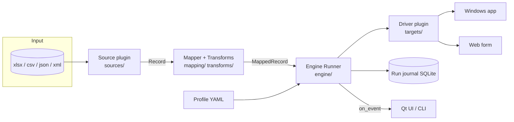

# AutoInput – Refined Architecture

Refinement of `brief.md`. Goal: one tool that feeds **many kinds of input** (Excel, CSV, JSON, XML, …)
into **one or more target apps** (Windows desktop, web forms, …) with a clear, safe UX and code that is
easy to extend.

---

## 1. Key changes vs. the brief

| Area | Brief | Refined | Why |
|---|---|---|---|
| Packaging | Poetry | **uv** + `pyproject.toml` (PEP 621, src layout) | Much faster, lockfile, standard metadata |
| GUI | PyQt6 | **PySide6** | Official Qt binding, LGPL (no GPL obligation for internal/commercial distribution) |
| Data reading | pandas for everything | **python-calamine** (xlsx/xls/xlsb/ods), stdlib `csv`, `json`, **defusedxml** | Rows are typed one-by-one, a DataFrame adds ~60 MB to the exe for no benefit. calamine is 5–10× faster than openpyxl. defusedxml blocks XXE / billion-laughs |
| Encoding detect | chardet | **charset-normalizer** | Faster, more accurate, maintained |
| Target apps | Hard-wired pywinauto | **Driver plugins**: `uia` (Windows, pywinauto), `mac` (macOS Accessibility, pyobjc), `web` (Playwright), `dry_run` | Same mapping/engine reused for Windows, macOS & web targets |
| What to type | Field → locator only | **Profile (YAML)**: connect info + fields + *steps per record* (`click New → fill_all → click Save → wait`) | Real data-entry apps need navigation between records, not just typing |
| Source ↔ Target | Single mapping | **Mapping (YAML)** links *any* source columns → *profile* fields | One profile reused by many files; one file can feed several profiles |
| Events | Global singleton EventBus called from worker thread | Per-run `on_event` callback → bridged to **Qt Signal** | Touching widgets from a non-GUI thread crashes Qt; no hidden globals |
| Run flags | Mutating global `settings.debug.dry_run` at runtime | Immutable `RunOptions` passed to the runner | Testable, no cross-run leakage |
| Pause/step | Busy-wait loop `sleep(0.1)` | `threading.Event` based `RunControl` | No CPU spin, instant response |
| Errors | `class ImportError` dataclass exception | `AutoInputError` hierarchy | Original shadowed Python's built-in `ImportError` |
| Row errors | Raise on first bad field | Collect **all** field errors per row; validate *before* running | User fixes the file once instead of run → fail → fix loops |
| Recovery | None | **SQLite run journal** → resume, “retry failed rows”, CSV error report | Long runs get interrupted; never re-enter duplicate data |
| Safety | None | **Kill-switch hotkey** (`Ctrl+Alt+Q`), countdown before start, clipboard restore | Automation hijacks keyboard/mouse; user must always be able to stop it |
| Privacy | Values logged in clear text | `sensitive: true` fields are masked in logs/UI events | CCCD / phone numbers are PII |
| Debug flows | Only via GUI | **CLI** (`typer`): `inspect`, `validate`, `run --dry-run --rows 5-10` | Debug each stage (parse → map → drive) separately, headless, scriptable |

---

## 2. Tech stack

| Layer | Choice |
|---|---|
| Language | Python 3.12 |
| Env / build | uv, hatchling, PyInstaller (one-folder exe) |
| GUI | PySide6 (Qt 6), QSS theme, Model/View tables |
| CLI | typer + rich |
| Config / schema | pydantic v2, pydantic-settings, PyYAML (`safe_load` only) |
| Sources | python-calamine, csv, json, defusedxml, charset-normalizer |
| Drivers | pywinauto (Windows), pyobjc Accessibility + pynput (macOS), Playwright (web, any OS) |
| Key syntax | Neutral `Control+S` / `ControlOrMeta+S` (core/keys.py), translated per driver |
| Logging | loguru (per-flow binding, rotating files) |
| Persistence | sqlite3 (stdlib) run journal |
| Hotkey | pynput (kill-switch) |
| Quality | ruff (lint+format), mypy, pytest, pytest-qt, pre-commit |

Optional extras keep installs small: `uv sync --extra windows --extra web`.

---

## 3. Architecture



Layers depend **inward only**: `ui`/`cli` → `engine` → (`sources`, `mapping`, `targets`) → `domain`.
`domain` has no third-party dependencies except pydantic.

### Extension points (all use the same `Registry`)

| Add a new… | Do this |
|---|---|
| Input format | Subclass `Source`, decorate with `@source_registry.register(".ext")` |
| Transform | `@transform("name")` on a `str -> str` function |
| Target technology | Subclass `Driver`, `@driver_registry.register("name")` |
| Target app / screen | Add a YAML file in `profiles/` (no code) |
| File → app wiring | Add a YAML file in `mappings/` or create it in the UI |

---

## 4. Project structure

```
AutoInput/
├── pyproject.toml
├── profiles/                 # Target app definitions (YAML, no code)
├── mappings/                 # Source → profile field mappings (YAML)
├── samples/                  # Example input files
├── src/autoinput/
│   ├── domain/               # Pure models + errors (no I/O)
│   ├── core/registry.py      # Generic plugin registry
│   ├── sources/              # Input readers (plugins)
│   ├── transforms/           # Value transforms (plugins)
│   ├── mapping/              # Mapper, validation, auto-suggest
│   ├── targets/              # Drivers: dry_run, uia, web (plugins)
│   ├── engine/               # Runner, RunControl, journal, kill-switch
│   ├── infra/                # Settings, logging, YAML storage
│   ├── cli.py                # Headless entry point
│   └── ui/                   # PySide6 app (state, worker, pages, widgets)
└── tests/
```

---

## 5. UX flow (3-step wizard)

```
┌ 1. Nguồn dữ liệu ┐  ┌ 2. Ánh xạ & Kiểm tra ┐  ┌ 3. Chạy ┐
│ drag & drop file │→ │ pick target profile  │→ │ dry-run / step / live │
│ auto-detect enc, │  │ auto-suggest mapping │  │ 3-2-1 countdown        │
│ delimiter, sheet │  │ live validation ✔/✖  │  │ progress, per-row status│
│ preview 200 rows │  │ per row, save mapping│  │ retry failed, export    │
└──────────────────┘  └──────────────────────┘  └────────────────────────┘
```

UX rules applied:
- Each step can’t continue until valid; the reason is shown inline, not in a popup.
- Dry-run is **on by default** for a new mapping.
- Long work runs in a `QThread`; UI never freezes.
- Always-visible stop: toolbar button + global `Ctrl+Alt+Q`.
- Keyboard: `Ctrl+O` open, `F5` run, `F6` pause/resume, `F10` step, `Esc` stop.

---

## 6. Debugging each flow separately

```bash
autoinput inspect samples/customers.csv              # parse only
autoinput validate samples/customers.csv -m mappings/crm_customer.yaml   # parse + map + validate
autoinput run samples/customers.csv -m mappings/crm_customer.yaml --dry-run --rows 1-3
autoinput run ... --step                              # confirm each record in terminal
```

Logs: `<data_dir>/logs/autoinput.log` (all), bound with `flow=source|mapping|driver|engine`;
filter with `grep "flow=driver"`. Screenshots on error: `<data_dir>/screenshots/`.

---

## 7. Roadmap ideas

- Locator **inspector/recorder** (hover a control → copy `auto_id` into profile).
- Image-based fallback driver (OpenCV template matching) for apps with no accessibility tree.
- Database / Google Sheets / REST sources (just new `Source` plugins).
- Run scheduler + headless service mode.
