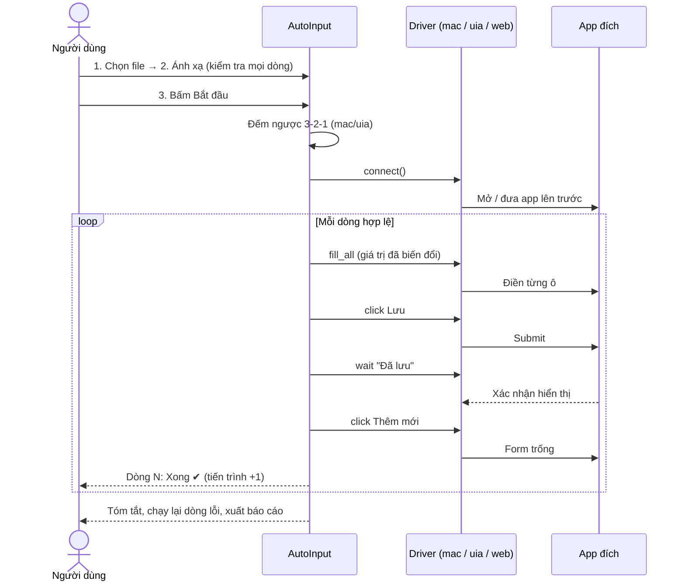

# Hướng dẫn chạy: tự động điền → submit → dòng tiếp theo

Tài liệu này mô tả **chính xác app làm gì, lúc nào, trên màn hình nào** khi nhập liệu tự động,
trên **macOS, Windows** và **web**.

---

## 1. Bức tranh tổng thể

Khi chạy có **2 cửa sổ** liên quan:

| Cửa sổ | Vai trò |
|---|---|
| **AutoInput** (app này) | Chọn file, ánh xạ cột, bấm chạy, theo dõi tiến trình, dừng khẩn cấp |
| **Ứng dụng đích** | App/website cần nhập liệu (CRM, phần mềm kế toán, form web…) |

AutoInput có 3 màn hình (wizard bên trái):

```
[1. Nguồn dữ liệu] → [2. Ánh xạ & Kiểm tra] → [3. Chạy nhập liệu]
```

Mỗi dòng dữ liệu được xử lý theo **kịch bản `record_steps`** khai báo trong profile (YAML), ví dụ:

```yaml
record_steps:
  - { action: fill_all }                                # 1. điền tất cả trường
  - { action: click, target: save_button }              # 2. submit
  - { action: wait,  target: toast_saved, timeout: 10 } # 3. chờ app xác nhận đã lưu
  - { action: click, target: new_button }               # 4. mở form trống cho dòng tiếp theo
```

---

## 2. Chuẩn bị theo nền tảng

| Loại ứng dụng đích | Driver | Cài đặt | Quyền cần cấp |
|---|---|---|---|
| Website / web app (mọi OS) | `web` | `uv sync --extra gui --extra web`, rồi cài Chromium theo mục 3 | Không |
| App desktop **macOS** | `mac` | `uv sync --extra gui --extra mac` | **Accessibility** + **Input Monitoring** |
| App desktop **Windows** | `uia` | `uv sync --extra gui --extra windows` | Không (chạy cùng quyền với app đích; app đích chạy Admin thì AutoInput cũng phải Admin) |

### Cấp quyền trên macOS (làm 1 lần)

1. **System Settings → Privacy & Security → Accessibility** → bật cho app đang chạy AutoInput
   (Terminal / iTerm / VS Code, hoặc `AutoInput.app` nếu đã đóng gói).
   *Cần để đọc/điền control của app khác.*
2. **System Settings → Privacy & Security → Input Monitoring** → bật cho cùng app đó.
   *Cần cho phím dừng khẩn cấp toàn cục `⌃⌥Q`.*
3. Thoát hẳn và mở lại Terminal/AutoInput sau khi cấp quyền.

Nếu thiếu quyền, AutoInput báo lỗi rõ ràng ngay ở bước kết nối, **chưa thao tác gì** lên app đích.

### Tìm locator (cách AutoInput tìm ô nhập)

| Nền tảng | Công cụ | Ví dụ locator |
|---|---|---|
| macOS | `uv run autoinput ax-tree --app "Tên App"` hoặc Xcode → *Accessibility Inspector* | `{ role: AXTextField, identifier: fullName }` |
| Windows | *Accessibility Insights* / `inspect.exe` | `{ auto_id: txtFullName }` |
| Web | DevTools (F12) | `{ label: "Họ và tên" }`, `{ css: "#save" }` |

---

## 3. Chạy thử ngay (demo có sẵn, chạy được trên Mac/Windows/Linux)

Repo có sẵn form web mẫu [samples/demo_form.html](../samples/demo_form.html), profile
[profiles/demo_web_form.yaml](../profiles/demo_web_form.yaml) và mapping
[mappings/demo_web_form.yaml](../mappings/demo_web_form.yaml).

Chuẩn bị một lần:

```bash
uv sync --extra gui --extra web
uv run playwright install chromium
```

Các lệnh bên dưới dùng cùng file và mapping. Chọn cách gán biến theo terminal bạn dùng:

```bash
FILE=samples/customers.csv
MAP=mappings/demo_web_form.yaml
```

PowerShell dùng cú pháp gán biến riêng:

```powershell
$FILE = "samples/customers.csv"
$MAP = "mappings/demo_web_form.yaml"
```

Sau đó dùng các lệnh chung:

```bash
uv run autoinput inspect "$FILE"                         # xem file nguồn
uv run autoinput validate "$FILE" -m "$MAP"              # kiểm tra dữ liệu
uv run autoinput run "$FILE" -m "$MAP"                   # chạy thử (mặc định)
uv run autoinput run "$FILE" -m "$MAP" --live            # nhập thật
uv run autoinput -v run "$FILE" -m "$MAP" --rows 1-3     # chạy thử dòng 1–3, log chi tiết
uv run autoinput run "$FILE" -m "$MAP" --live --step     # nhập thật, xác nhận từng dòng
uv run autoinput ax-tree --app "TextEdit"                 # macOS: xem cây control
uv run autoinput gui                                      # mở giao diện
```

Kết quả mong đợi: Chromium mở form, dòng 1 và 2 được điền → **Lưu** → chờ *"Đã lưu"* → **Thêm mới**
→ dòng tiếp theo. Dòng 3 bị đánh dấu *Dữ liệu lỗi* (ngày 31/02 và số điện thoại sai) và **không** được nhập.

---

## 4. Diễn biến từng bước: màn hình nào, lúc nào

### Giai đoạn A — Chuẩn bị (chỉ trên cửa sổ AutoInput, app đích chưa bị chạm tới)

| # | Màn hình AutoInput | Người dùng làm | App làm |
|---|---|---|---|
| A1 | **1. Nguồn dữ liệu** | Kéo thả / chọn file (`⌘O` / `Ctrl+O`) | Tự nhận định dạng, encoding, dấu phân cách, sheet; hiện 200 dòng đầu |
| A2 | 1. Nguồn dữ liệu | Chọn sheet / dòng tiêu đề nếu cần | Đọc lại file, báo số dòng & cột. Nút **Tiếp tục** chỉ bật khi đọc được dữ liệu |
| A3 | **2. Ánh xạ & Kiểm tra** | Chọn *ứng dụng đích* (profile) | Tự gợi ý cột nguồn ↔ trường đích (không phân biệt dấu) |
| A4 | 2. Ánh xạ & Kiểm tra | Sửa cột / biến đổi / bắt buộc | Kiểm tra **toàn bộ** dòng sau 0,3 giây; dòng lỗi tô cam kèm lý do |
| A5 | 2. Ánh xạ & Kiểm tra | (Tuỳ chọn) **Lưu mapping…** | Ghi YAML để lần sau mở lại |

> Ở giai đoạn này **không có thao tác nào** lên app đích. Có thể làm lại bao nhiêu lần tuỳ ý.

### Giai đoạn B — Bắt đầu chạy (màn hình **3. Chạy nhập liệu**)

| # | Thời điểm | Cửa sổ đang hiển thị | Diễn biến |
|---|---|---|---|
| B1 | Chọn tuỳ chọn | AutoInput | *Chạy thử* (mặc định **bật**), *Từng dòng*, *Dừng khi lỗi*, *Chỉ các dòng* (vd `1-10, 15`), *Nghỉ giữa các dòng* |
| B2 | Bấm **▶ Bắt đầu** (`⌘R` / `F5`) | AutoInput | Ghép dữ liệu ↔ mapping, lọc dòng, ghi lần chạy vào nhật ký SQLite. Wizard bị khoá để tránh đổi cấu hình giữa chừng |
| B3 | Đếm ngược **3-2-1** *(chỉ driver `mac`/`uia`, chế độ thật)* | AutoInput (số to màu vàng) | **Buông chuột & bàn phím.** Phím dừng khẩn cấp đã hoạt động. Bấm Dừng lúc này sẽ huỷ trước khi chạm vào app đích |
| B4 | Kết nối | **Chuyển sang app đích** | `mac`: tìm app theo `bundle_id`/`app_name`, mở nếu chưa chạy, **đưa lên trước**. `uia`: tìm cửa sổ theo `title_re`, mở `exe` nếu cần, focus. `web`: mở Chromium (hoặc gắn vào Chrome đang đăng nhập qua `cdp_url`) và vào `url` |

> Driver `web` **không cần focus**: không đếm ngược, không chiếm chuột/bàn phím — bạn vẫn làm việc khác được.
> Driver `mac`/`uia` **chiếm focus**: trong lúc chạy đừng click hay gõ phím.

### Giai đoạn C — Vòng lặp mỗi dòng (lặp lại cho đến hết file)

Ví dụ với kịch bản *fill_all → Lưu → chờ "Đã lưu" → Thêm mới*:

| # | Bước | Màn hình app đích | Bảng trạng thái trong AutoInput |
|---|---|---|---|
| C0 | Kiểm tra dữ liệu dòng | — | Dòng lỗi dữ liệu → **Dữ liệu lỗi** (cam), **bỏ qua**, sang dòng sau, app đích không bị chạm |
| C1 | Bắt đầu dòng | Form trống | Dòng chuyển **Đang nhập…** (xanh dương), bảng tự cuộn tới dòng đó |
| C2 | `fill_all` | Các ô được điền **theo thứ tự khai báo trong `fields`** (nên khớp thứ tự Tab của form) | Log: `fill {locator} = 'giá trị'` (trường `sensitive` bị che `••••45`) |
| C3 | `click save_button` | Nút **Lưu** được bấm → app gửi dữ liệu | — |
| C4 | `wait toast_saved` | App xử lý (spinner/“Đang lưu…”) → hiện **“Đã lưu”** | Chờ tối đa `timeout` giây. **Đây là bước đồng bộ quan trọng nhất**: không chuyển dòng khi app chưa lưu xong |
| C5 | `click new_button` | Form được xoá trắng, sẵn sàng cho dòng mới | Dòng chuyển **Xong** (xanh lá), thanh tiến trình +1 |
| C6 | Giữa 2 dòng | Form trống | *Chế độ thường*: nghỉ `delay` giây rồi sang C1 với dòng sau. *Chế độ Từng dòng*: **tạm dừng**, AutoInput báo “Xong dòng N. Bấm ⌘↩ / F10 để nhập dòng tiếp theo” |

#### Khi một bước bị lỗi (vd: không tìm thấy nút, quá thời gian chờ)

| # | Diễn biến |
|---|---|
| E1 | Dừng kịch bản của dòng đó ngay tại bước lỗi |
| E2 | Chụp màn hình → `<data_dir>/screenshots/<thời gian>_row<N>.png` |
| E3 | Chạy `on_error_steps` (vd `press Escape`) để đưa app đích về trạng thái sạch |
| E4 | Dòng chuyển **Thất bại** (đỏ) kèm lý do. Nếu bật *Dừng khi lỗi* → kết thúc; nếu không → sang dòng tiếp |

### Giai đoạn D — Kết thúc (quay lại cửa sổ AutoInput)

| # | Diễn biến |
|---|---|
| D1 | Đóng kết nối (đóng Chromium nếu do AutoInput mở; app desktop **giữ nguyên**) |
| D2 | Tóm tắt: `✔ Hoàn tất: X xong • Y thất bại • Z dữ liệu lỗi • T giây` |
| D3 | **↻ Chạy lại dòng lỗi**: tự điền danh sách dòng lỗi vào *Chỉ các dòng* và chạy lại — không nhập trùng dòng đã xong |
| D4 | **Xuất báo cáo…**: CSV (mở được bằng Excel, giữ tiếng Việt) gồm dòng, trạng thái, lý do, ảnh chụp |

### Sơ đồ trình tự



---

## 5. Viết kịch bản cho app của bạn

| Kiểu app | `record_steps` gợi ý |
|---|---|
| Form tự reset sau khi lưu | `fill_all` → `click save` → `wait form_empty_marker` |
| Phải bấm **Thêm mới** trước khi nhập | `click new` → `fill_all` → `click save` → `wait saved` |
| Có hộp thoại xác nhận | … → `click save` → `wait confirm_dialog` → `press Enter` → `wait confirm_dialog, state: gone` |
| Lưu bằng phím tắt | `fill_all` → `press "ControlOrMeta+S"` → `wait saved` |
| App chậm, không có dấu hiệu nào | `click save` → `sleep 1.5` *(phương án cuối — ưu tiên `wait`)* |

Quy tắc:
- **Luôn có một bước `wait`** sau khi submit. Nó quyết định độ tin cậy của cả lần chạy.
- Phím tắt viết theo cú pháp chung: `Escape`, `Enter`, `Tab`, `Control+S`, `Meta+N`.
  `ControlOrMeta+S` = `⌘S` trên Mac, `Ctrl+S` trên Windows → một profile dùng được cả hai.
- Đánh dấu `sensitive: true` cho CCCD, số tài khoản… để không lộ trong log.
- `on_error_steps` nên đưa app về màn hình nhập liệu sạch (đóng dialog, huỷ form).
- macOS: app Electron/Java bỏ qua việc điền trực tiếp → thêm `input_mode: keyboard` trong `connect`.

---

## 6. Điều khiển trong lúc chạy

| Hành động | macOS | Windows | Ghi chú |
|---|---|---|---|
| Bắt đầu | `⌘R` | `F5` / `Ctrl+R` | |
| Tạm dừng / Tiếp tục | `⌘P` | `F6` / `Ctrl+P` | Dừng sau thao tác hiện tại, không bỏ dở giữa một ô |
| Dòng tiếp (chế độ Từng dòng) | `⌘↩` | `F10` / `Ctrl+Enter` | |
| Dừng | `Esc` / `⌘.` | `Esc` / `Ctrl+.` | Chỉ khi cửa sổ AutoInput đang focus |
| **Dừng khẩn cấp toàn cục** | `⌃⌥Q` | `Ctrl+Alt+Q` | Hoạt động **cả khi app đích đang focus** (driver mac/uia) |

Đổi phím dừng khẩn cấp: biến môi trường `AUTOINPUT_KILL_SWITCH="<ctrl>+<alt>+x"`.

---

## 7. Gỡ lỗi từng giai đoạn riêng biệt

Dùng lại các lệnh `inspect`, `validate`, `run` và `ax-tree` ở mục 3; chỉ cần đổi `FILE` và `MAP`
sang file dữ liệu, mapping của bạn.

| Triệu chứng | Nguyên nhân thường gặp | Cách xử lý |
|---|---|---|
| “chưa cấp quyền Accessibility” | macOS chặn | Mục 2, rồi mở lại Terminal/AutoInput |
| `Control not found: {...}` | Locator sai hoặc màn hình chưa hiện | Kiểm tra bằng `ax-tree`/Inspector; thêm `wait` trước bước đó |
| Điền xong nhưng app không nhận giá trị (Mac) | App Electron/Java | `input_mode: keyboard` |
| Dòng sau bị điền đè lên dòng trước | Thiếu `wait` sau submit | Thêm `wait` cho dấu hiệu “đã lưu” |
| Ký tự tiếng Việt bị lỗi (Windows) | Gõ phím qua bộ gõ Unikey/Telex | Tắt bộ gõ khi chạy; driver ưu tiên điền trực tiếp, không gõ phím |

Log: `<data_dir>/logs/autoinput.log` (lọc `flow=driver`, `flow=engine`…).
`<data_dir>` = `~/Library/Application Support/AutoInput` (macOS), `%LOCALAPPDATA%\AutoInput` (Windows).
